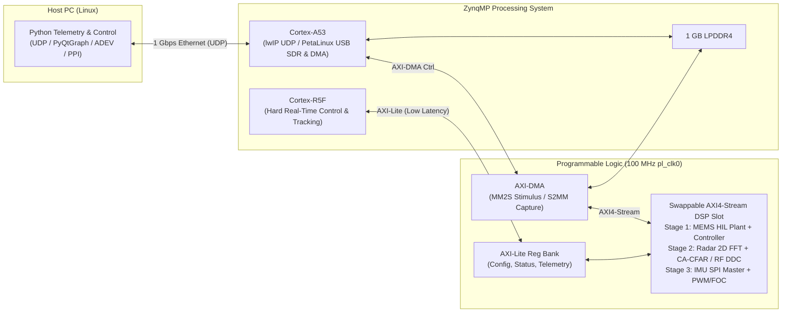

# Avnet ZUBoard 1CG Master Project Plan
**RF · Radar DSP · MEMS Gyro Control & Physics HIL · Tracking · Robotics Control**

- **Target Hardware:** Avnet ZUBoard 1CG (AMD Zynq UltraScale+ XCZU1CG)
  - **APU:** Dual-core ARM Cortex-A53 (1 GB LPDDR4, GbE, USB 2.0 Host, MicroSD, QSPI)
  - **RPU:** Dual-core ARM Cortex-R5F (deterministic hard real-time control/tracking)
  - **PL Fabric:** ~81K logic cells (~37,440 LUTs), **216 DSP48E2 slices**, 3.8 Mb BRAM (108 × 36 Kb)
  - **Expansion:** 1× MikroE Click socket (mikroBUS), 3× Samtec high-speed expansion headers (1 standard + 2 PS-GTR/TXR2)
  - *Hardware Note:* Although mechanically SYZYGY-like, the ZUBoard 1CG is not strictly SYZYGY-compliant on power/VIO rails—always verify pinouts and voltages before attaching off-the-shelf SYZYGY ADC/DAC pods.
- **Host Environment:** Linux with **Vivado 2024.2** and **Vitis Unified IDE 2024.2**
- **Design Philosophy:** Build **one reusable ZUBoard 1CG DSP & Control platform** (AXI4-Stream + AXI-Lite + AXI-DMA + GbE telemetry) and layer progressive, cross-pollinating projects onto it.

---

## 1. Post-MATLAB FPGA SoC Workflow

Moving away from MATLAB HDL Coder to an open, transparent, industry-standard engineering workflow:

| Stage | Replaces (MATLAB) | Tooling | Purpose |
| :--- | :--- | :--- | :--- |
| **Golden Model & Math** | MATLAB / Simulink | **Python** (`numpy`, `scipy`, `matplotlib`) | Algorithm prototyping, fixed-point quantization studies, Bode plots, Range-Doppler plots, Allan Deviation (ADEV). |
| **PL Hardware Design** | HDL Coder | **SystemVerilog** + **AMD Vivado IP** | Write core streaming DSP/physics/control blocks in SystemVerilog for full control over pipelining, bit growth, and DSP48E2 inference. Use Vivado IP for boilerplate (Xilinx FFT, AXI-DMA, Clocking Wizard). Optionally add **Vitis HLS (C++)** later for matrix-heavy blocks (CFAR, MPC). |
| **RTL Verification** | HDL Verifier | **cocotb + Verilator** (+ **Surfer** / GTKWave) | Drive live SystemVerilog directly from Python testbenches against golden-model vectors; 10–20× faster than Vivado XSim. |
| **SoC Build & Firmware** | Embedded Coder | **Vivado 2024.2** (Tcl-scripted) + **Vitis 2024.2** | Git-reproducible hardware builds. Bare-metal / FreeRTOS on **Cortex-R5F** for deterministic loops; bare-metal + **lwIP UDP** (Stages 0–1) → **PetaLinux** (Stage 2+ for USB SDR drivers) on **Cortex-A53**. |
| **Host Dashboard** | Simulink Scopes | **Python** (`pyqtgraph` / WebSocket / Foxglove) | Real-time 60 FPS visualization and automated hardware characterization over Gigabit Ethernet. |

---

## 2. Optional ~$100 Modular Hardware Shopping List

You need **$0 extra hardware for Stage 0 and Stage 1**. When ready for real-world RF, radar, and robotics hardware in Stages 2–3, these plug straight into the ZUBoard's native **USB 2.0 Host**, **mikroBUS Click socket**, and **UART/GPIO**:

1. **RTL-SDR Blog V4 + Dipole Antenna Kit (~$45)** — Real 500 kHz–1.76 GHz RF I/Q streams (~2.4 MSPS) via USB Host or PC-to-GbE bridge for DDCs, polyphase channelizers, and passive bistatic radar.
2. **MikroE 6DOF IMU Click (~$25–$29)** — Plugs directly into the onboard mikroBUS Click socket (no wiring) for live SPI/I2C MEMS gyro + accelerometer fusion, bias/ADEV characterization, and gimbal stabilization.
3. **24 GHz Radar Module (~$10–$15, e.g., HLK-LD2450 multi-target UART module or HB100/CDM324 Doppler) + Micro Pan-Tilt Servo Kit (~$12–$15)** — Physical target tracking and closed-loop gimbal pointing.

**Total:** ~$95–$100 (purchased incrementally as you reach each stage).

---

## 3. Shared System Architecture & Repository Layout



### Target Repository Layout (`zub1cg-dsp-lab/`)

```text
zub1cg-dsp-lab/
├── Makefile                  # Top-level targets: sim, lint, bit, xsa, sw
├── docs/
│   └── PLAN.md
├── model/                    # Python golden models & fixed-point quantization
│   ├── fixed_point.py        # Quantization & bit-growth helpers
│   ├── mems_gyro_model.py    # Stage 1: 2-DOF gyro ODE, PLL/AGC/FTR, Bode & ADEV
│   ├── radar_sim_model.py    # Stage 2: FMCW/Pulse-Doppler echoes, 2D FFT, CFAR, Kalman/IMM
│   └── robotics_eskf.py      # Stage 3: Error-State EKF & LQR/PID gimbal model
├── rtl/
│   ├── common/               # Reusable AXI & DSP primitives (Stages 0–3)
│   │   ├── axil_regfile.sv   # Parameterized AXI4-Lite register bank
│   │   ├── sv_nco_cordic.sv  # Phase accumulator + sin/cos generator
│   │   ├── sv_cic_decim.sv   # Cascaded integrator-comb decimator
│   │   ├── sv_fir_mac.sv     # Time-multiplexed DSP48E2 FIR filter
│   │   ├── sv_lockin.sv      # I/Q lock-in demodulator
│   │   └── sv_pi_ctrl.sv     # Saturated anti-windup PI controller
│   ├── mems_hil/             # Stage 1: MEMS plant + closed-loop controller
│   ├── radar_rf/             # Stage 2: Radar echo gen, corner-turn, 2D CA-CFAR, PFB/DDC
│   └── robotics_io/          # Stage 3: Timestamped SPI IMU master, high-res PWM/QEI
├── sim/                      # cocotb + Verilator testbenches
├── hw/                       # Vivado 2024.2 Tcl scripts & XDC constraints
│   ├── scripts/
│   │   ├── create_bd.tcl
│   │   └── build_bit.tcl
│   └── constraints/
│       └── zub1cg_base.xdc
├── sw/                       # Vitis 2024.2 Unified IDE firmware
│   ├── a53_net_bridge/       # lwIP UDP <-> AXI-DMA & AXI-Lite bridge
│   └── r5f_realtime/         # Stage 1 supervisor / Stage 2 tracker / Stage 3 ESKF+control
└── host/                     # PC visualization & automated hardware test scripts
    ├── zuboard_client.py
    ├── gyro_dashboard.py
    ├── radar_ppi_gui.py
    └── gimbal_3d_viewer.py
```

---

## 4. Stage 0: Reusable ZUBoard 1CG Shell & Modern Toolchain (Weeks 1–2)

### Step 0.1 — Linux Toolchain & Board Files
1. **Vivado 2024.2 Board Files (`zub1cg`):**
   - **GUI:** Vivado 2024.2 → **Tools → Vivado Store → Boards** → install **Avnet ZUBoard 1CG**.
   - **CLI / Reproducible Git:** Clone `https://github.com/Xilinx/XilinxBoardStore` (`2024.2` branch) and configure in Tcl:
     ```tcl
     set_param board.repoPaths [list "/path/to/XilinxBoardStore/boards/Avnet/zub1cg"]
     ```
2. **Simulation & Python Environment:**
   - Install **Verilator** (≥ 5.0) and **Surfer** (or GTKWave).
   - Create a Python venv with `cocotb`, `pytest`, `numpy`, `scipy`, `matplotlib`, `pyqtgraph`.

### Step 0.2 — First Verified RTL Block (`sv_nco_cordic.sv`)
- Implement a 32-bit phase accumulator + 16-bit signed `sin`/`cos` generator with AXI4-Stream (`tdata`, `tvalid`, `tready`, `tlast`).
- Verify in `sim/test_nco.py` (`cocotb` + Verilator):
  - Sweep tuning words, capture 4096 samples, compute NumPy FFT, assert **SFDR > 90 dBc** and phase continuity.

### Step 0.3 — Tcl-Scripted ZUBoard 1CG Base Block Design
- Script `hw/scripts/create_bd.tcl` in Vivado 2024.2:
  - **Zynq UltraScale+ MPSoC** (`zub1cg` preset: LPDDR4, GEM3 GbE, UART1, QSPI/SD, `pl_clk0 = 100 MHz`).
  - **AXI-Lite Control Plane:** `M_AXI_HPM0_LPD` → SmartConnect → `axil_regfile` + `axi_dma` CSRs.
  - **AXI-DMA Data Plane:** `S_AXI_HP0_FPD` ↔ `axi_dma` (64-bit MM2S & S2MM channels, simple register mode initially).
  - **Swappable DSP Slot:** `axi_dma.M_AXIS_MM2S` → `dsp_slot` (`sv_nco_cordic` + loopback mux) → `axi_dma.S_AXIS_S2MM`.
- Synthesize, verify timing closure (WNS ≥ 0 ns at 100 MHz), and export `zub1cg_base.xsa`.

### Step 0.4 — Vitis 2024.2 Bare-Metal + lwIP UDP Bridge
- Build a Vitis 2024.2 Unified IDE platform from `zub1cg_base.xsa`:
  - **Cortex-A53 (`standalone` + `lwip220`):** UDP server over GbE (`192.168.1.10`) supporting `REG_READ`, `REG_WRITE`, `DMA_CAPTURE`, and `DMA_PLAYBACK`.
  - **Cortex-R5F (`standalone`):** Deterministic timer heartbeat + AXI-Lite status polling test.
- Write `host/zuboard_client.py` to tune the NCO over UDP, trigger AXI-DMA captures, and plot live waveforms/FFTs on Linux.

### Stage 0 Exit Criteria
- [ ] `make sim` passes `cocotb` + Verilator NCO testbench with SFDR > 90 dBc.
- [ ] `make bit` builds `zub1cg_base.xsa` from Tcl with clean timing closure.
- [ ] Host Python script updates PL registers over GbE and displays real-time DMA-captured waveforms.

---

## 5. Stage 1: Closed-Loop MEMS Vibratory Gyroscope HIL (Weeks 3–6) — *$0 Hardware*

*Goal:* Build a realistic 2-DOF MEMS gyroscope physics plant and full precision closed-loop controller on the ZU1CG while assembling the core SystemVerilog DSP library reused in Stages 2 and 3.

### Step 1.1 — Governing Physics & Python Golden Model (`model/mems_gyro_model.py`)
Model a 2-DOF coupled vibratory gyroscope with Coriolis coupling, quadrature stiffness error, thermal drift, and Brownian/electronic noise:

$$\ddot{x} + \frac{\omega_x}{Q_x}\dot{x} + \omega_x^2 x + \omega_{xy} y = \frac{F_d}{m} + 2\Omega_z \dot{y}$$

$$\ddot{y} + \frac{\omega_y}{Q_y}\dot{y} + \omega_y^2 y + \omega_{xy} x = \frac{F_s}{m} - 2\Omega_z \dot{x} + n_{\text{th}}(t)$$

- **Baseline Parameters (AXI-Lite programmable):**
  - Drive resonance $f_x = 16.0\text{ kHz}$, $Q_x = 2000$ (with injectable frequency drift $\Delta f_x(T)$)
  - Sense resonance $f_y = 16.2\text{ kHz}$ (tunable from 200 Hz mode-split down to 0 Hz mode-matched), $Q_y = 500$
  - Quadrature error $\omega_{xy}$ equivalent to 50–500 °/s
  - True angular rate $\Omega_z(t) \in [-500, +500]\text{ °/s}$ (step, chirp, or arbitrary DMA waveform)
- **Fixed-Point & Timing Strategy:**
  - Physics update rate $f_s = 1\text{ MHz}$ ($\approx 62.5\times$ oversampling of the 16 kHz carrier).
  - With `pl_clk0 = 100 MHz`, each physics step has **100 clock cycles**, enabling time-multiplexed **32-bit fixed-point states (Q4.28 / Q1.31)** and RK2/Tustin integration without quantization limit cycles in high-$Q$ poles.

### Step 1.2 — Reusable SystemVerilog DSP Library (`rtl/common/`)
Each module verified in `cocotb` against `model/mems_gyro_model.py`:
1. `sv_nco_cordic.sv` *(from Stage 0)* — drive carrier $\sin(\phi)$, $\cos(\phi)$.
2. `sv_cic_decim.sv` + `sv_fir_mac.sv` — 1 MHz → 10 kHz / 1 kHz decimation with strong stopband notch at $2f_x = 32\text{ kHz}$.
3. `sv_lockin.sv` — I/Q mixer + low-pass filter extracting baseband in-phase and quadrature envelopes.
4. `sv_pi_ctrl.sv` — 32-bit accumulator PI loop with programmable $K_p, K_i$, clamp, and anti-windup.

### Step 1.3 — PL MEMS Physics Plant (`mems_plant_2dof.sv`)
- 1 MHz time-multiplexed FSM computing spring, damping, quadrature, Coriolis ($2\Omega_z \dot{x}, 2\Omega_z \dot{y}$), and actuation forces ($F_d, F_s$).
- Pseudo-Gaussian noise generator (4-tap LFSR/xoshiro sum) for mechanical thermal noise + front-end ADC noise.
- **Verification:** Open-loop impulse & frequency sweep in `cocotb` matching Python $f_x, f_y, Q_x, Q_y$ within < 0.1%.

### Step 1.4 — PL Closed-Loop Gyro Controller (`mems_ctrl_top.sv`)
1. **Drive-Axis PLL:** Demodulates $x$ with $\cos(\phi)$ → PI loop → tunes NCO frequency to track $f_x(T)$ at exact 90° resonance phase.
2. **Drive-Axis AGC:** Demodulates $x$ with $\sin(\phi)$ → PI loop regulating oscillation amplitude $x_0 = A_{\text{ref}}$.
3. **Sense Lock-In & Quadrature Nulling:** Separates Coriolis rate ($I_y$, in-phase with $\dot{x}$) from quadrature error ($Q_y$, in-phase with $x$); slow PI loop nulls quadrature error.
4. **Force-to-Rebalance (FTR) Loop:** Compensates $I_y$ and re-modulates onto the drive carrier to generate $F_s$ driving $y \to 0$; the FTR command becomes the wide-bandwidth linear rate output $\hat{\Omega}_z$.

### Step 1.5 — Cortex-R5F Supervisor & Characterization Dashboard
- **Cortex-R5F (`r5f_realtime`):** 1 kHz deterministic state machine: `IDLE → OPEN_LOOP_SWEEP → PLL_ACQUIRE → AGC_LOCK → QUAD_NULL → FTR_ACTIVE → FAULT`.
- **Host GUI (`host/gyro_dashboard.py`):** Live step response, closed-loop Bode plot, quadrature rejection measurement, scale-factor linearity, and **Allan Deviation (ADEV)** plot (Angle Random Walk & Bias Instability).

### Stage 1 Exit Criteria
- [ ] Drive PLL locks autonomously from cold start and tracks injected ±50 Hz thermal drift without losing lock.
- [ ] Quadrature nulling suppresses 200 °/s equivalent stiffness coupling by > 40 dB.
- [ ] Closed-loop FTR matches ground-truth $\Omega_z(t)$ with measured bandwidth > 100 Hz and validated ADEV curve over GbE.

---

## 6. Stage 2: FMCW / Pulse-Doppler Radar & RF DSP + Multi-Target Tracker (Weeks 7–11)

*Reuses:* Stage 0 AXI-DMA/GbE shell + Stage 1 `sv_nco_cordic`, `sv_cic_decim`, `sv_fir_mac`.  
*Optional Hardware:* **RTL-SDR Blog V4 (~$45)** for live RF IQ streams (can start 100% synthetic first).

### Step 2.1 — Synthetic Multi-Target Radar & RF Signal Generator (PL / Python)
- Parameterizable synthetic radar baseband/IF echo generator in PL (or DMA-fed from Python): multiple moving targets with configurable range, radial velocity (Doppler), RCS, ground clutter, and AWGN.
- **RF Front-End Upgrade Path:** Stream real IQ from an **RTL-SDR Blog V4** (via PC-to-GbE UDP initially, or directly via ZUBoard USB Host once PetaLinux is enabled on A53).

### Step 2.2 — PL Radar / RF Processing Pipeline (`rtl/radar_rf/`)
- **RF Mode (Wideband DDC / Polyphase Channelizer / Passive Radar):**
  - Multi-channel Polyphase Filter Bank (PFB) or digital downconverter (`sv_nco_cordic` + `sv_cic_decim` + `sv_fir_mac`).
  - Optional Cross-Ambiguity Function (CAF) correlator for passive bistatic radar using FM/broadcast illuminators.
- **Radar Mode (Range-Doppler + CFAR):**
  - Fast-time Hamming/Hann windowing → **Xilinx FFT IP** (Range FFT, e.g., 256–1024 pts).
  - **BRAM Corner-Turn Matrix** (transpose Range × Chirp CPI buffer, e.g., 256 × 64 fits easily in ZU1CG's 3.8 Mb BRAM).
  - Slow-time windowing → **Xilinx FFT IP** (Doppler FFT) → magnitude-squared detector.
  - **2D CA-CFAR / OS-CFAR** sliding-window detector in SystemVerilog emitting sparse `(range_bin, doppler_bin, snr)` detection packets over AXI-Stream/AXI-Lite.

### Step 2.3 — Cortex-R5F Multi-Target Tracker & Host PPI Visualizer
- **Cortex-R5F:** Consumes CFAR detections every Coherent Processing Interval (CPI):
  - Connected-component clustering & parabolic peak interpolation.
  - **Global Nearest Neighbor (GNN)** (or JPDA) data association.
  - **Constant-Velocity / Coordinated-Turn Extended Kalman Filter (EKF) or Interacting Multiple Model (IMM)** tracker with track initiation (`M-of-N` logic), coasting, and deletion.
- **Host GUI (`host/radar_ppi_gui.py`):** Live Range-Doppler heatmap, CFAR threshold overlay, and real-time multi-target tracks (position, velocity vectors, covariance ellipses).

### Stage 2 Exit Criteria
- [ ] PL Range-Doppler + 2D CA-CFAR matches Python golden model detections bit-accurately in `cocotb`.
- [ ] R5F tracks ≥ 4 crossing/maneuvering targets deterministically per CPI with logged latency/jitter.
- [ ] Live RF spectrum/waterfall or passive Doppler capture demonstrated with RTL-SDR V4.

---

## 7. Stage 3: Real MEMS IMU Sensor Fusion & Closed-Loop Tracking Gimbal (Weeks 12+)

*Reuses:* Stage 0 shell, Stage 1 control/filter experience, Stage 2 R5F Kalman tracking.  
*Optional Hardware:* **MikroE 6DOF IMU Click (~$27)** + **24 GHz UART/Doppler Radar (~$15)** + **Micro Pan-Tilt Servo Kit (~$15)**.

### Step 3.1 — PL Deterministic Robotics I/O (`rtl/robotics_io/`)
- **Hardware SPI Master for MikroE 6DOF IMU Click:** Polls gyro + accelerometer at exact hardware-timed 1 kHz (zero OS jitter) with 64-bit hardware timestamps and exposes clean registers/FIFO to R5F.
- **Hardware PWM / Servo (or BLDC FOC) Controller:** Sub-microsecond resolution PWM outputs + optional quadrature encoder interface (QEI) + hardware watchdog/limit stops.
- **Optional HIL Mode:** 2-DOF pan-tilt gimbal / inverted pendulum rigid-body physics simulator in PL (using the Stage 1 fixed-point ODE pattern) to verify controllers before energizing physical actuators.

### Step 3.2 — Cortex-R5F Sensor Fusion & Control
- **1 kHz Error-State EKF (ESKF):** Fuses 6-DOF MEMS IMU measurements to estimate quaternion attitude and online 3-axis gyro bias (directly applying Allan Deviation & noise concepts learned in Stage 1).
- **Closed-Loop Gimbal Controller:** Cascaded LQR or rate/position PID loop combining IMU attitude stabilization with target azimuth/elevation setpoints from the Stage 2 Kalman tracker (or live 24 GHz radar module).

### Step 3.3 — Host 3D Attitude & Tracking Viewer
- **Host GUI (`host/gimbal_3d_viewer.py`):** Live 3D orientation cube/gimbal model, gyro bias convergence plots, target-lock error, and actuator command telemetry over GbE.

### Stage 3 Exit Criteria
- [ ] Zero-jitter 1 kHz SPI IMU acquisition verified on hardware (measured Allan Deviation of physical MEMS gyro).
- [ ] ESKF converges on attitude + gyro bias and stabilizes/steers the pan-tilt gimbal onto a moving target in real time.

---

## 8. ZU1CG Resource Budget Across All Stages

| Resource | ZU1CG Total | Stage 0 + 1 (MEMS HIL) | Stage 2 (Radar/RF) | Stage 3 (Robotics I/O) |
| :--- | :---: | :---: | :---: | :---: |
| **LUTs** | ~37,440 (~81K LC) | ~6,000 – 9,000 (~20%) | ~12,000 – 18,000 (~45%) | ~5,000 – 8,000 (~18%) |
| **DSP48E2 Slices** | 216 | ~24 – 36 (~15%) | ~60 – 110 (~45%) | ~16 – 30 (~12%) |
| **Block RAM (36Kb)** | 108 (3.8 Mb) | ~12 – 18 (~15%) | ~36 – 64 (~55%) | ~8 – 14 (~10%) |
| **Clocking** | 100 MHz `pl_clk0` | 100 MHz fabric / 1 MHz HIL | 100–200 MHz streaming | 100 MHz fabric / 1 kHz loop |

Because the DSP Slot is swappable, each stage fits comfortably inside the ZU1CG with strong timing margin—and Stages 2 + 3 can even be combined into a single capstone bitstream (Radar-Guided Stabilized Tracking Gimbal) well within the 216 DSP slice budget.
